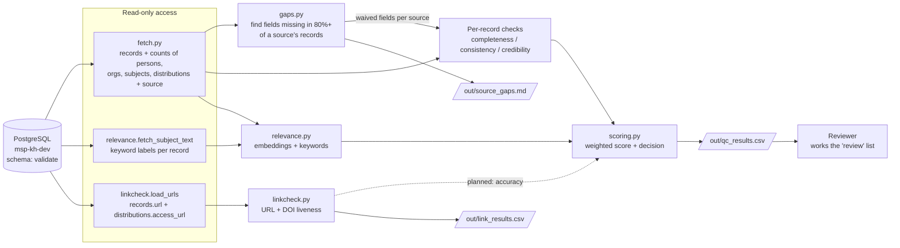
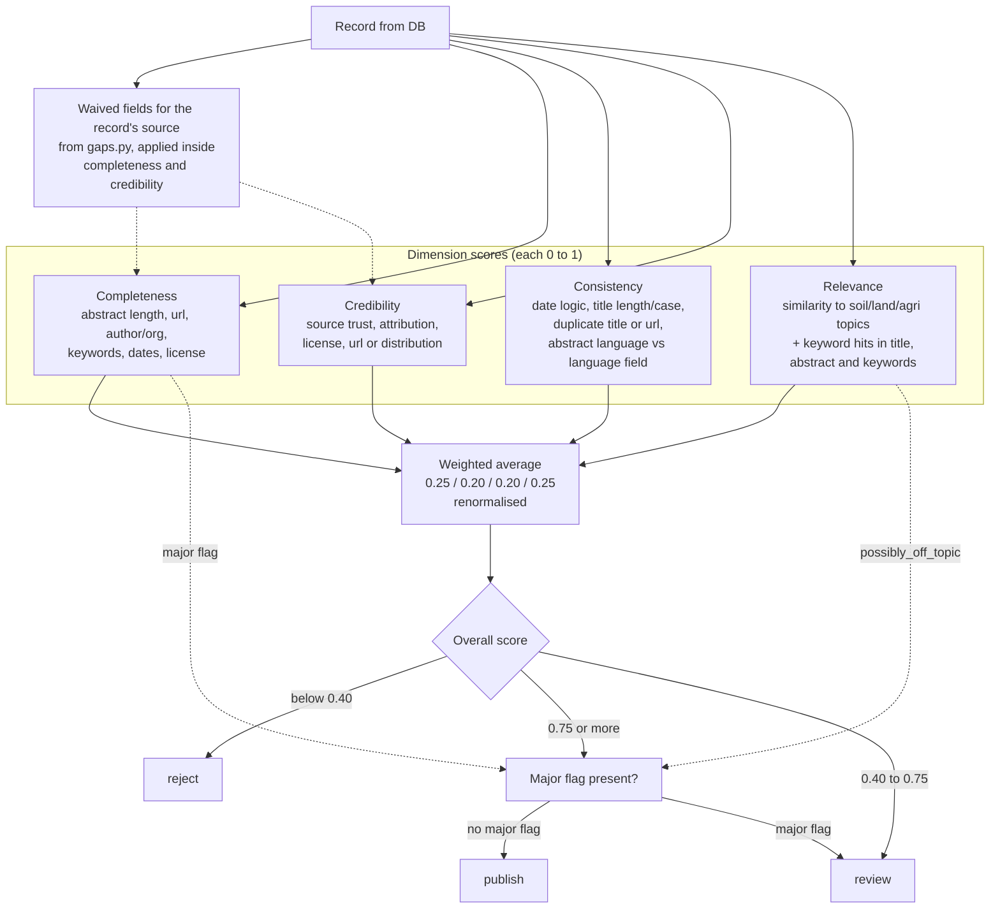
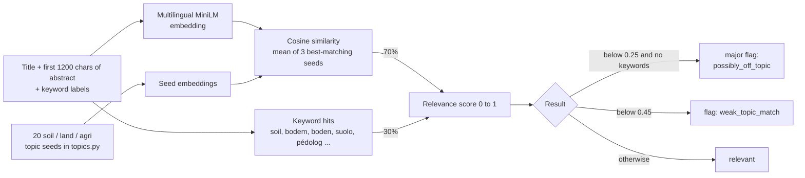
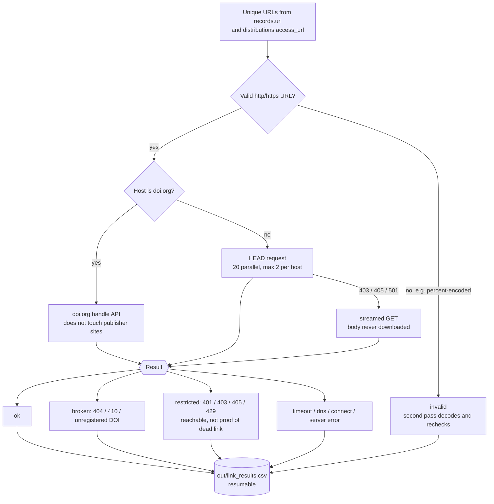
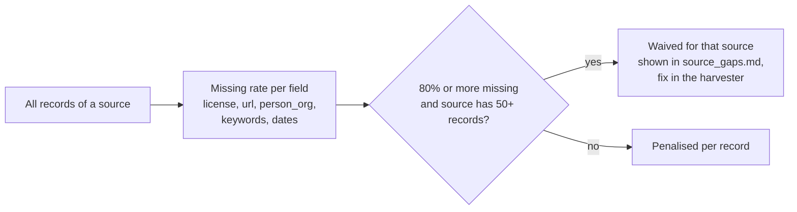

# SoilWise Data Quality Check

Quality assurance for Knowledge Hub records (TOR p. 25): validate **relevance, credibility,
completeness, accuracy and consistency** with automated checks, plus manual review where needed.

Data source: PostgreSQL `msp-kh-dev`, schema `validate` (main table `records`, ~25k harvested
metadata records from 14 sources).

## Status

| Dimension | State |
|---|---|
| Completeness | Done (rule-based, source-aware) |
| Consistency | Done (dates, titles, duplicates, language) |
| Credibility | Partial (offline signals only; source trust is flat) |
| Relevance | Done (multilingual embeddings + keywords); cut-offs untuned |
| Accuracy | In progress: link/DOI checker built (`qc.linkcheck`), not yet in the score |

The runner writes a CSV only. It never modifies the database.

## How it works

Diagrams are Mermaid and render on GitHub / GitLab / most Markdown viewers.

### 1. End-to-end data flow



Solid arrows exist today. The dotted arrow (link results feeding the score) is the next step.
Nothing is written back to the database.

### 2. What happens to one record



### 3. Relevance check



Embeddings are cached in `out/emb_cache.npz`, so changing cut-offs or keywords re-runs in minutes.

### 4. Link / DOI checker



### 5. Source-aware scoring

A field missing in 80%+ of a source's records (and the source has 50+ records) is a harvester-level
gap, not a record-level defect. It is reported once in `out/source_gaps.md` and **not** penalised per
record, so reviewers see records that are unusual for their source.



## Setup

```bash
python3 -m venv .venv && source .venv/bin/activate
pip install -r requirements.txt
pip install torch --index-url https://download.pytorch.org/whl/cpu   # CPU build, much smaller
cp envExample.txt .env      # then fill in DB_USER and DB_PASSWORD
```

`.env` holds credentials and is git-ignored. `envExample.txt` is the template.

## Usage

```bash
python -m qc.discover --samples 2   # schema_report.md: tables, columns, row counts, samples
python -m qc.profile                # profile_report.md: null rates, value distributions, duplicates
python -m qc.source_report          # out/source_gaps.md: fields systematically missing per source
python -m qc.runner                 # out/qc_results.csv: scores and decisions (~16 min first run, cached after)
python -m qc.runner --no-relevance  # skip the embedding step (~6 min)
python -m qc.runner --limit 500     # quick test run
python -m qc.linkcheck              # out/link_results.csv: URL/DOI liveness (long, resumable)
```

All database access is read-only. The link checker contacts third-party sites, politely
(low concurrency, max 2 parallel requests per host, no body downloads).

## Layout

```
qc/
  config.py        weights, thresholds, source trust, language map, relevance cut-offs
  db.py            connection from DB_* env vars (read-only)
  models.py        Record, CheckResult
  fetch.py         loads records plus relation counts
  gaps.py          source-level gap detection (waivers)
  topics.py        soil/land/agri topic seeds and keywords
  checks/          completeness.py, consistency.py, credibility.py, relevance.py
  scoring.py       weighted score -> publish / review / reject
  runner.py        runs everything, writes CSV
  linkcheck.py     URL and DOI liveness, resumable
  source_report.py per-source gap report
  discover.py      schema discovery
  profile.py       data profiling
```

See `qc/README.md` for the checks and scoring, and `docs/FINDINGS.md` for the data profile
and results.

## Known data issues found so far

- Most `distributions.access_url` values (about 34k) are fully percent-encoded
  (`https%3A%2F%2F...`) and cannot be opened as links: a harvester/ingest defect.
- License is missing in 82-100% of records in 12 of 14 sources.
- impact4soil, prepsoil and islandr lack authors, keywords and dates systematically.

## Planned next

Full detail in [`docs/NEXT_STEPS.md`](docs/NEXT_STEPS.md).

1. Second link-check pass on decoded URLs, then add link results to the score as the accuracy dimension.
2. Calibrate relevance cut-offs and thresholds on ~50 labeled records.
3. Decide whether food/livestock content is in scope (affects eufarmbook).
4. Persist results (`approval_status` or a separate `qc` schema) and a reviewer queue.
