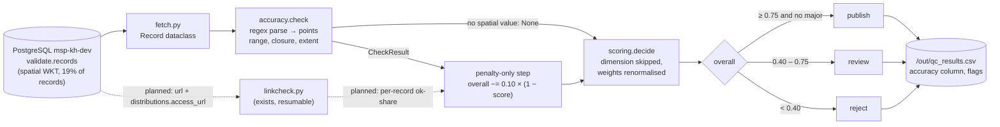

# Accuracy

> One of the five quality dimensions required by the TOR (p. 25). Scored with weight **0.10**,
> applied as a **penalty-only** component (it can lower a score, never raise it).
>
> **In one sentence:** *"Are the values in the record actually correct — does the map shape make
> sense, and does the link really work?"*

## What it is (plain words)

The other checks ask whether information is *present* (completeness) or *agrees with itself*
(consistency). Accuracy asks the hardest question: **does the value agree with reality?**

> **Update (run5):** link results are now scored. Per record: ok / (ok + broken) over definitive answers only (`qc/linkscore.py`); timeouts, restricted and invalid URLs are unknown. Accuracy = the lower of the spatial and link scores, flag `broken_link`, still penalty-only. Sections below that say links are "not yet scored" describe the state before run5.

Two kinds are in scope for this project:

1. **Is the map shape real? (implemented.)** 19% of records carry a `spatial` value — a polygon
   describing *where* the data covers. It must be a valid, geographic, non-degenerate shape:
   coordinates inside the world (longitude ±180, latitude ±90), a closed ring, and a real area
   (not a flat line or a single point).
2. **Do the links actually work? (built, not yet scored.)** `qc/linkcheck.py` tests every URL
   and DOI and writes `out/link_results*.csv` — but those results are **not part of the score
   yet** (plan in [`NEXT_STEPS.md`](NEXT_STEPS.md) §3). This is the biggest remaining gap.

**Analogy:** completeness checks the recipe is written down; accuracy checks the cake you'd bake
from it is actually edible — the shape on the map exists, the link opens.

## How we check it

Code: [`qc/checks/accuracy.py`](../qc/checks/accuracy.py) — `check(record) -> CheckResult | None`.

### The idea in plain words

If a record has **no** map shape, this check simply doesn't apply to it (the score is skipped and
the other weights are re-balanced) — we refuse to hand out free points for something untested.

If it **has** a shape, we start at 100% and subtract for each problem. Two problems are serious
("major"): a shape we cannot read at all, or coordinates outside the world.

**Why penalty-only?** This check only covers 19% of records. If a perfect score *added* points,
records with a map would float over the publish line just for having one — we saw exactly that
happen in an earlier run (132 decisions changed for the wrong reason). So since run4 the rule is:
**a good shape adds nothing; a bad shape costs points.**

### The exact rules (technical)

Returns **`None`** when the record has no `spatial` value (dimension skipped, other weights
renormalised). Otherwise:

| Condition | Flag / major | Penalty |
|---|---|---|
| not `POLYGON`/`MULTIPOLYGON`, or fewer than 4 points | **major** `spatial_unparseable` | −0.60 |
| any \|lon\| > 180 or \|lat\| > 90 | **major** `coordinates_out_of_range` | −0.60 |
| odd number of coordinates | `odd_coordinate_count` | −0.20 |
| `POLYGON` ring not closed (first ≠ last point) | `polygon_not_closed` | −0.20 |
| zero width **or** zero height (a point/line, not an area) | `degenerate_extent` | −0.30 |

The check is plain text/number parsing — no internet, no geometry library, fast enough to run
inside the main scoring pass.

### How it enters the score (technical)

With `ACCURACY_PENALTY_ONLY = True` in [`qc/config.py`](../qc/config.py):

```text
overall = weighted average of completeness / consistency / credibility / relevance (renormalised)
overall -= 0.10 × (1 − accuracy_score)      # can only lower the score, never raise it
```

### Output

A `CheckResult` with `dimension="accuracy"` (or `None` → empty column for that record); written
to the `accuracy` column of `out/qc_results.csv`.

## Data flow



Reading the diagram in plain words: the record comes out of the database; if it has a map shape
it goes through the geometry checks and any problems *subtract* from the final score (if it has
no shape, the step is skipped and the other weights rebalance); the decision and the CSV follow —
while the link checker (dotted line) is *planned* as a future input.

## What we found

(from `docs/FINDINGS.md`, run3 / run4)

- Applies to **4,857 records (19%)**; the other 81% are scored without it.
- Average accuracy: **0.991**; 4,705 of 4,857 score a perfect 1.0. **No** out-of-range
  coordinates, unreadable geometry or unclosed rings were found.
- **152 records have a zero-extent polygon** (a point or line instead of an area):
  **149 from bonares, 3 from data.europa.eu** — a small, concrete defect to raise with bonares.
- run3 (weighted) changed 132 decisions, mostly as a lift artefact; **run4 made accuracy
  penalty-only**, reversing those moves. Versus the pre-accuracy run only 57 decisions differ.
- Link side: 56,721 unique URLs tested; **33,844 invalid** (percent-encoded — they all decode
  fine, this is a harvester bug), **21,196 ok** of 22,872 testable (92.7%), 78 broken. A 3,000-URL
  decoded sample estimates ≈82% work, ≈7% broken, with **one dead host** serving 1,718 URLs
  (`geoportale.lamma.rete.toscana.it`). A 30-second retry showed **85 of 101 timing-out hosts
  never recover** — mostly dead or blocked, not slow.

## What is not finished

- **Link results are not part of the score** — the dimension is only half-built. The plan
  ([`NEXT_STEPS.md`](NEXT_STEPS.md) §3): per-record share of working links, weight 0.10, with
  timeouts and "restricted" responses counted as *unknown, not failed* until the dead-host
  question is settled.
- **The full decoded pass is deferred** — the 34k percent-encoded URLs need the harvester fix
  first (ticket T1); the 3,000-URL sample answered the question but is not per-record data.
- **Dead-host confirmation** — maps.bonares.de (836 timeouts) and the Sardinian/Walloon servers
  must be confirmed from another network or with the owners: one computer cannot tell a dead host
  from a host that blocks its address.
- **Coverage is 19%.** 81% of records have no accuracy signal at all.
- **Not yet checked:** does the title match the real DOI (Crossref)? Are dates plausible? Do
  thumbnails load? Does `raw_metadata` match the promoted columns?

## Suggestions

1. **Do `NEXT_STEPS.md` §3 next.** The link data already exists (`out/link_results_clean.csv`);
   mapping it per record is the single highest-value remaining accuracy work — a "complete"
   record whose link is dead is the clearest accuracy failure a user will actually hit.
2. **Let accuracy raise flags, not only points.** Keep the penalty as is, but make a broken link
   or a degenerate polygon a **major flag** so bad records reach review regardless of their
   average.
3. **Extend the map check cheaply:** compare the shape's centre against the country/region named
   in the title or abstract (even a coarse "is it in Europe?" test catches copy-paste polygons).
4. **Add a DOI/title cross-check for articles** via Crossref: the DOI resolves *and* the returned
   title resembles the record's title — true field-level accuracy for ~11,000 journal articles,
   reusing the resumable fetch pattern of `linkcheck.py`.
5. **Re-run the decoded link pass after the harvester fix** so every record gets a link signal,
   not only the 19% with a map shape.

## One-sentence summary

> Accuracy validates the values that can be objectively tested — today the map polygons (19% of
> records, 152 broken shapes found, mostly from bonares) — and can only *lower* a score, never
> raise it; the link checker is built and full of results but is not connected to the score yet.

See also: [`CREDIBILITY.md`](CREDIBILITY.md), [`COMPLETENESS.md`](COMPLETENESS.md),
[`CONSISTENCY.md`](CONSISTENCY.md), [`RELEVANCE.md`](RELEVANCE.md).
