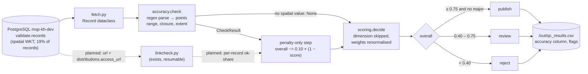

# Accuracy

> TOR p. 25: the Knowledge Hub's quality assurance must validate **accuracy** of knowledge
> objects. Scored by `qc.runner` with weight **0.10**, applied as a **penalty-only** component.

## What it is

Accuracy asks: *are the values in the record actually correct?* Where completeness asks "is the
field there?" and consistency asks "do the fields agree with each other?", accuracy asks "does the
value agree with reality?".

Two kinds of accuracy are in scope for this project:

1. **Spatial plausibility (implemented)** — the `spatial` WKT polygon must be a real,
   geographic, non-degenerate shape: parseable, coordinates within lon ±180 / lat ±90, ring
   closed, non-zero extent.
2. **Link / DOI liveness (built, not yet scored)** — the URLs in `records.url` and
   `distributions.access_url` must actually resolve. `qc/linkcheck.py` and its variants produce
   `out/link_results*.csv`, but the results do not feed the score yet (see
   `docs/NEXT_STEPS.md` §3).

## How we achieve it

Code: [`qc/checks/accuracy.py`](../qc/checks/accuracy.py) — `check(record) -> CheckResult | None`.

### Spatial WKT validation

Returns **`None`** when the record has no `spatial` value: the dimension is then *skipped* for
that record and the remaining weights are renormalised (rather than scoring an untested 1.0).
For records that do have a polygon:

| Condition | Flag / major | Penalty |
|---|---|---|
| not `POLYGON`/`MULTIPOLYGON`, or fewer than 4 points | **major** `spatial_unparseable` | −0.60 |
| any \|lon\| > 180 or \|lat\| > 90 | **major** `coordinates_out_of_range` | −0.60 |
| odd number of coordinates | `odd_coordinate_count` | −0.20 |
| `POLYGON` ring not closed (first ≠ last point) | `polygon_not_closed` | −0.20 |
| zero width **or** zero height (a point or line, not an area) | `degenerate_extent` | −0.30 |

The check is pure regex/number parsing — no network, no geometry library, fast enough to run with
the main scoring pass.

### Penalty-only scoring (important)

Accuracy applies to only ~19% of records (those with a spatial value). As a normal weighted
dimension, a perfect score would *lift* borderline records over the 0.75 publish line purely
because they happen to have a polygon — run3 showed exactly this artefact (132 decisions changed,
largest score change 0.097, mostly review→publish). Since run4
(`ACCURACY_PENALTY_ONLY = True` in `qc/config.py`):

```text
overall = weighted average of completeness / consistency / credibility / relevance (renormalised)
overall -= 0.10 × (1 − accuracy_score)      # can only lower the score, never raise it
```

### Output

A `CheckResult` with `dimension="accuracy"` (or `None` → no column value for that record);
written to the `accuracy` column of `out/qc_results.csv`.

## Data flow



## Current results

From `docs/FINDINGS.md` (run3 / run4):

- Applies to **4,857 records (19%)**; the other 81% are scored without it.
- Mean accuracy **0.991**; 4,705 of 4,857 score a perfect 1.0. No out-of-range coordinates, no
  unparseable geometry, no unclosed rings found.
- **152 records have a zero-extent polygon** (`degenerate_extent`): 149 from bonares, 3 from
  data.europa.eu — a small, concrete data defect to raise with bonares.
- run3 (weighted) changed 132 decisions, mostly as a lift artefact; **run4 made accuracy
  penalty-only**, reversing those moves. Versus the pre-accuracy run only 57 decisions differ.
- Link side: 56,721 unique URLs checked; 33,844 invalid (percent-encoded, all decode cleanly),
  21,196 ok of 22,872 testable (92.7%), 78 broken. Decoded sample (~3,000): ≈82% ok, ≈7% broken,
  with one dead host (`geoportale.lamma.rete.toscana.it`, 1,718 URLs). 30 s retry: 85 of 101
  timing-out hosts never recovered — mostly dead or blocked, not slow.

## What remains

- [ ] **Link results are not part of the score** — the dimension is only half-built. Plan in
      `NEXT_STEPS.md` §3: per-record share of ok links, weight 0.10 in `WEIGHTS`, `timeout` and
      `restricted` counted as *unknown* (not failed) until the dead-host question is settled.
- [ ] **Full decoded pass is deferred** — the 34k percent-encoded URLs need the harvester fix
      first (ticket T1); the 3,000-URL sample answered the question but is not per-record data.
- [ ] **Dead-host confirmation** — maps.bonares.de (836 timeouts), the Sardinian/Walloon servers
      etc. must be confirmed from another network or with the owners before being called dead;
      one machine/IP cannot distinguish a dead host from a blocked one.
- [ ] **Coverage is 19%.** 81% of records have no accuracy signal at all, and nothing else in
      the dimension has been implemented for them.
- [ ] **Not yet checked:** numeric/text accuracy (e.g. does the title match the DOI's Crossref
      record?), dates vs. real-world event dates, thumbnails, `raw_metadata` vs. promoted values
      (partly a consistency topic too).

## Suggestions

1. **Do `NEXT_STEPS.md` §3 next.** The data already exists (`out/link_results_clean.csv`);
   mapping it per record is the single highest-value remaining accuracy work — a "complete" record
   whose link is dead is the clearest accuracy failure users will actually hit.
2. **Treat accuracy as evidence, not only a penalty.** Consider a two-sided rule: penalties stay
   as they are, but a *broken* link or degenerate polygon can also raise a **major flag**
   (`broken_link`, `degenerate_extent`) so bad records reach review regardless of their average.
3. **Extend spatial checks cheaply:** compare the polygon's centroid against the country/region
   named in title or abstract (even a coarse "is it in Europe?" test catches copy-paste polygons),
   and validate that the WKT matches the EPSG:4326 assumption (values look like lon/lat but the
   column stores raw text).
4. **Add a DOI/title cross-check for articles** via Crossref: DOI resolves *and* the returned
   title is close to the record title. That is true field-level accuracy for ~11k journal
   articles, and it reuses the resumable fetch pattern of `linkcheck.py`.
5. **Once the harvester fix lands, re-run the decoded link pass** so every record gets a link
   signal, not just the 19% with geometry.

See also: [`CREDIBILITY.md`](CREDIBILITY.md), [`COMPLETENESS.md`](COMPLETENESS.md),
[`CONSISTENCY.md`](CONSISTENCY.md), [`RELEVANCE.md`](RELEVANCE.md).
