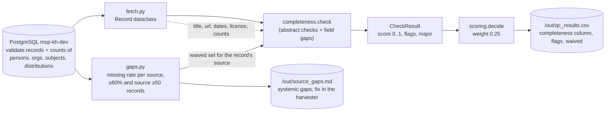

# Completeness

> TOR p. 25: the Knowledge Hub's quality assurance must validate that knowledge objects are
> **complete** before they are made available. This is one of the five dimensions scored by
> `qc.runner` (weight **0.25**, tied for the highest).

## What it is

Completeness asks: *does the record carry the fields a user needs to find, judge and open the
item?* A record with no abstract cannot be assessed, a record with no link cannot be opened, and a
record with no author, keywords, dates or license cannot be trusted or reused.

It is deliberately the most "material" of the checks: every gap is a concrete, countable field
problem, not an interpretation. The dimension covers:

| Field | Why it matters |
|---|---|
| `abstract` | the only text a reviewer sees in a search result |
| `url` / distributions | without a link the object is unreachable |
| persons / organizations | attribution: who wrote or produced it |
| subjects (keywords) | findability in the hub's search |
| dates (publication / creation / updated) | recency, ordering, filtering |
| `license` | reuse rights: can the hub show and republish it |

## How we achieve it

Code: [`qc/checks/completeness.py`](../qc/checks/completeness.py) — `check(record, waived)`.

A rule-based penalty model: the score starts at **1.0** and each detected gap subtracts a fixed
amount (floor 0). Abstract problems are checked first and are never waived; the field gaps are
skipped when the field is a **systemic gap for the record's source** (see waivers below).

### Penalty table

| Condition | Flag / major | Penalty |
|---|---|---|
| abstract missing or placeholder (`tbd`, `n/a`, `none`, `untitled`, ...) | **major** `abstract_missing_or_placeholder` | −0.50 |
| abstract under 50 chars (`SHORT_ABSTRACT_CHARS`) | **major** `abstract_very_short` | −0.35 |
| abstract under 200 chars (`MIN_ABSTRACT_CHARS`) | `abstract_short` | −0.15 |
| no author and no organization | `no_author_or_org` | −0.15 |
| no `url` | `no_url` | −0.10 |
| no subjects (keywords) | `no_keywords` | −0.10 |
| none of the three dates present | `no_dates` | −0.10 |
| no `license` | `no_license` | −0.05 |

All thresholds and penalties live in [`qc/config.py`](../qc/config.py).

### Source-aware waivers

A field missing in **80%+ of a source's records** (source of 50+ records) is a harvester defect,
not a record defect — penalising it per record would send every record of that source to review
(see `docs/FINDINGS.md`, first vs. second run). [`qc/gaps.py`](../qc/gaps.py) computes the waiver
set per source; waived fields are removed from the penalty list and reported once in
`out/source_gaps.md`. Abstract checks and consistency are **never** waived.

### Output

A `CheckResult` with `dimension="completeness"`, `score` 0..1, `flags` (minor) and `major`
(major flags block automatic publish). `runner.py` writes it to the `completeness` column of
`out/qc_results.csv`, plus the record's `waived` column.

## Data flow

## Current results

From `docs/FINDINGS.md` (run3, 25,129 records):

- Mean completeness score: **0.903** — the second-strongest dimension.
- Most common flags: `no_license` 6,282 · `no_keywords` 5,205 · `abstract_short` 4,885 ·
  `no_author_or_org` 2,458 · `no_dates` 2,056 · `abstract_very_short` 986 · `no_url` 978.
- Systemic gaps waived per source: license in 12 of 14 sources; impact4soil also lacks
  person/org, keywords and dates; fao and ngr lack `url` (see `out/source_gaps.md`).
- Profile: license missing in 77.5% of all records, 986 abstracts under 50 chars,
  4,885 between 50 and 199 chars.

## What remains

- [ ] **Waived fields are invisible per record.** The `waived` column lists them, but the
      `completeness` score looks healthy for e.g. impact4soil even though 92% of its records have
      no author — the problem is only visible in `out/source_gaps.md`.
- [ ] **License presence ≠ license quality.** Any non-empty string counts; `Wiley Online Library
      User Agreement` and `CC BY` score the same.
- [ ] **No check on distributions.** Records can have a `url` but zero, dead or untyped
      distributions (format, access_url) — not covered.
- [ ] **Penalty weights are guesses.** −0.05 for a missing license vs −0.15 for a missing author
      was never calibrated against a reviewer's judgement.
- [ ] **Thumbnail, `spatial`, `language` are not scored** (all three are heavily or occasionally
      missing: thumbnail 91.4%, spatial 80.7%).

## Suggestions

1. **Split "structure" from "substance".** Keep the field-gap penalties, but report a simple
   completeness percentage (fields present / fields expected per resource type) next to the score
   — reviewers read percentages faster than penalty-derived scores.
2. **Make license meaningful.** Map values to classes (`permissive`, `restrictive`,
   `unknown / publisher agreement`) and score only `permissive` + `unknown` as present; the
   `no_license` flag then becomes `license_unknown`, which is a different, actionable problem.
3. **Score per resource type.** A Dataset with no spatial extent or a Journal Article with no DOI
   is more incomplete than a Project with no abstract. Expected-field sets per `resource_type`
   would make the check fairer and sharper.
4. **Calibrate the penalties** when the labeled sample (`out/labeling_sample.xlsx`) returns:
   regress reviewer judgement on the per-flag indicators and let the data set the weights.
5. **Keep waivers, but surface them.** Add a per-record `systemic_gap` note to the review export
   so a reviewer of an impact4soil record knows the missing author is expected, not a defect.

See also: [`CONSISTENCY.md`](CONSISTENCY.md), [`CREDIBILITY.md`](CREDIBILITY.md),
[`RELEVANCE.md`](RELEVANCE.md), [`ACCURACY.md`](ACCURACY.md).
