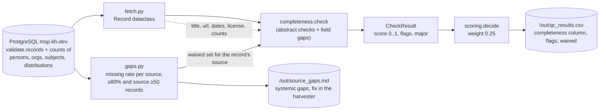

# Completeness

> One of the five quality dimensions required by the TOR (p. 25). Scored with weight **0.25**
> (tied for the highest).
>
> **In one sentence:** *"Is everything that should be in this record actually there?"*

## What it is (plain words)

Imagine a library index card that has a title but no author, no date, no summary and no link to
the book. The information on it may be perfectly true — but it is still a *useless* card.

Completeness asks exactly that question for each of the 25,129 records: **is the needed
information present?** A record can be relevant and trustworthy and still fail here:

| Missing field | Why it hurts the user |
|---|---|
| abstract | nobody can tell what the object is without reading it |
| link (`url`) | nobody can open the object |
| author / organization | nobody knows who is responsible for it |
| keywords (subjects) | it will not appear in the hub's search |
| dates | nobody knows if it is old or new |
| license | legally, the hub may not be allowed to reuse it |

**Analogy:** it is like checking a questionnaire before filing it — no blank answers where an
answer is required.

## How we check it

Code: [`qc/checks/completeness.py`](../qc/checks/completeness.py) — `check(record, waived)`.

### The idea in plain words

Every record starts at a perfect **100% (score 1.0)**. Every missing thing makes it drop a
little. A record with everything stays at 100%. A record missing a lot drops low — and a low
overall score sends it to **review** instead of **publish**. A badly incomplete abstract is a
**"major" flag**: it alone stops automatic publishing, even if the rest of the record is perfect.

### The exact rules (technical)

| Condition | Flag / major | Penalty |
|---|---|---|
| abstract missing or placeholder (`tbd`, `n/a`, `none`, `untitled`, ...) | **major** `abstract_missing_or_placeholder` | −0.50 |
| abstract under 50 chars (`SHORT_ABSTRACT_CHARS`) | **major** `abstract_very_short` | −0.35 |
| abstract under 200 chars (`MIN_ABSTRACT_CHARS`) | `abstract_short` | −0.15 |
| no author and no organization | `no_author_or_org` | −0.15 |
| no `url` | `no_url` | −0.10 |
| no subjects (keywords) | `no_keywords` | −0.10 |
| none of the three dates present | `no_dates` | −0.10 |
| no `license` | `no_license` | −0.05 |

Score = 1.0 minus the penalties, floored at 0. All numbers live in
[`qc/config.py`](../qc/config.py) and can be changed without touching the check itself.

### The smart rule: don't blame the record for the source's bug

**The problem we hit:** source *impact4soil* has 9,337 records with **no author in 92%**, **no
keywords in 95%**, **no dates in 92%**. That is not 9,337 bad records — that is **one broken
harvester**. If we punished every record individually, the entire source would flood the review
queue for one single reason.

**The rule:** if a field is missing in **80% or more of a source's records** (and the source has
at least 50 records), the record is **not punished** for it. The problem is reported **once** in
`out/source_gaps.md` as a ticket for the harvester owner: *"fix this at the source."*

This is done by [`qc/gaps.py`](../qc/gaps.py), which builds a *waiver set* per source. The
abstract checks are **never** waived — a short abstract is always a record-level problem.

**Result:** reviewers now only see records that are unusual *compared to their own source*.

### Output

A `CheckResult` with `dimension="completeness"`, a `score` from 0 to 1, `flags` (minor issues)
and `major` (serious issues that block automatic publish). `runner.py` writes it to the
`completeness` column of `out/qc_results.csv`, together with the record's `waived` column.

## Data flow

Reading the diagram in plain words: the record comes out of the database, the waiver list from
the source check travels alongside it, the completeness check applies its penalties, and the
result flows into the final score and the CSV report — while systemic gaps go to a separate
report for the harvester team.

## What we found

(from `docs/FINDINGS.md`, run3 and run4, 25,129 records; this dimension is identical in both runs)

- Average completeness score: **0.903 out of 1** — most records are fairly complete; the gaps
  cluster in specific sources.
- Most common problems: `no_license` 6,282 · `no_keywords` 5,205 · `abstract_short` 4,885 ·
  `no_author_or_org` 2,458 · `no_dates` 2,056 · `abstract_very_short` 986 · `no_url` 978.
- Systemic gaps waived per source: license missing in **12 of 14 sources**; impact4soil also
  lacks authors, keywords and dates; fao and ngr lack `url` (see `out/source_gaps.md`).
- Whole corpus: license missing in 77.5% of records, 986 abstracts under 50 characters,
  4,885 between 50 and 199 characters.

## What is not finished

- **The penalty numbers are guesses.** Why is a missing license only −0.05 but a missing author
  −0.15? Nobody has checked these against a real reviewer's judgement.
- **Presence ≠ quality.** Any non-empty license string counts as "has license" — `Wiley Online
  Library User Agreement` and `CC BY` score the same, although they mean very different things.
- **The record's own score hides waived gaps.** An impact4soil record looks healthy even though
  92% of its siblings have no author; that problem is only visible in `out/source_gaps.md`.
- **Not checked at all:** download links (distributions), thumbnails, `spatial`, `language`
  (thumbnail is missing 91.4% of the time, spatial 80.7%).

## Suggestions

1. **Report a simple percentage too** ("8 of 10 expected fields present") next to the score —
   non-technical reviewers read percentages faster than penalty-derived scores.
2. **Grade the license, don't just count it:** open (CC BY, CC0) = present, publisher agreement =
   "unknown", empty = missing. This turns a vague flag into an actionable one.
3. **Expect different fields per resource type.** A Dataset without spatial data is more
   incomplete than a Project without spatial data.
4. **Calibrate the penalties** with the labeled sample (`out/labeling_sample.xlsx`): let an
   expert's judgement set the numbers instead of guessing.
5. **Tell the reviewer about waivers** — add a short note in the review export so someone
   reviewing an impact4soil record knows the missing author is expected, not a defect.

## One-sentence summary

> Completeness starts every record at 100% and subtracts points for each missing field — but it
> wisely skips fields that are missing because the whole harvest source is broken, and reports
> those once to the harvester owner instead.

See also: [`CONSISTENCY.md`](CONSISTENCY.md), [`CREDIBILITY.md`](CREDIBILITY.md),
[`RELEVANCE.md`](RELEVANCE.md), [`ACCURACY.md`](ACCURACY.md).
