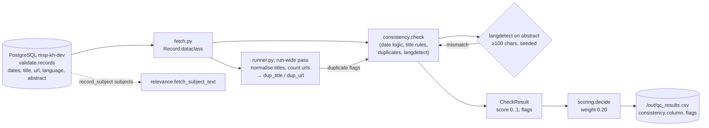

# Consistency

> One of the five quality dimensions required by the TOR (p. 25). Scored with weight **0.20**.
>
> **In one sentence:** *"Does the record contradict itself — or the rest of the collection?"*

## What it is (plain words)

Completeness looks at each field on its own: *"is the date there?"* Consistency looks at how the
fields **relate to each other**:

- **Dates that make sense** — a publication date in the *future*? Content created *after* it was
  published? An "updated" timestamp *before* creation? A time range whose end comes before its
  start? All impossible or suspicious.
- **Titles that look sane** — under 10 characters, over 250, or ALL CAPS is almost always a
  harvesting accident, not a real title.
- **Duplicates** — two records with the same title or the same link are probably the same object
  harvested twice. Showing both wastes the reviewer's time and confuses users.
- **Language that matches** — the record says the abstract is German, but the abstract is
  actually English? Then search, filters and translation all break.

**Analogy:** it is the "does the story hold together?" check. Every individual answer on the
form may be present (complete), but together they can still be nonsense.

## How we check it

Code: [`qc/checks/consistency.py`](../qc/checks/consistency.py) —
`check(record, dup_title, dup_url)`.

### The idea in plain words

Same style as completeness: start at **100% (1.0)** and subtract a little for each contradiction.
Nothing in this check is currently a "major" flag — consistency problems never block publishing
on their own, they only pull the overall score down.

### The exact rules (technical)

| Condition | Flag | Penalty |
|---|---|---|
| `publication_date` in the future | `publication_in_future` | −0.25 |
| `language` field ≠ `langdetect` result for the abstract (abstract ≥ 100 chars) | `language_mismatch` | −0.20 |
| title under 10 chars (`MIN_TITLE_CHARS`) | `title_too_short` | −0.20 |
| `temporal_end` before `temporal_start` | `temporal_end_before_start` | −0.15 |
| duplicate normalised title (across the whole run) | `duplicate_title` | −0.15 |
| duplicate `url` (across the whole run) | `duplicate_url` | −0.15 |
| `resource_creation_date` after `publication_date` | `created_after_published` | −0.10 |
| `resource_updated_date` before `resource_creation_date` | `updated_before_created` | −0.10 |
| title over 250 chars (`MAX_TITLE_CHARS`) | `title_too_long` | −0.10 |
| title is all caps | `title_all_caps` | −0.05 |

Details worth knowing (technical):

- **Language detection** uses the `langdetect` library with a fixed random seed
  (`DetectorFactory.seed = 0`), so the same record always gets the same answer. Only 15 language
  names are mapped (`LANG_CODES` in `config.py`); unmapped languages are skipped, not flagged.
  Detection is skipped for abstracts under 100 characters, where it is unreliable.
- **Duplicates are found across the whole corpus.** `runner.py` first builds counting maps of
  `title.lower()` (with punctuation removed) and of `url` over *all* records, then passes two
  true/false flags into the check. They therefore only work when scoring everything — not with
  `--limit 500`.
- **Nothing is waived here.** A systemic gap in a source never makes a future publication date
  acceptable — consistency problems are always record-level.

### Output

A `CheckResult` with `dimension="consistency"`, score 0..1 and flags; written to the
`consistency` column of `out/qc_results.csv`.

## Data flow

Reading the diagram in plain words: the record comes out of the database; before scoring, one
pass over the *whole* corpus finds duplicate titles and URLs; the check then tests date logic,
title rules and the declared language against the detected language; the result flows into the
final score and the CSV report.

## What we found

(from `profile_report.md` and `docs/FINDINGS.md`, 25,129 records)

- Average consistency score: **0.986 out of 1** — the strongest dimension; the corpus is
  internally quite coherent.
- Dates: **42** publications dated in the future, **78** created after published, **2** time
  ranges ending before they start.
- Duplicates: **205** groups share a normalised title, **122** groups share a URL, **0** duplicate
  identifiers.
- Titles: **82** under 10 chars, **38** over 250 chars, **205** in ALL CAPS.
- Language: 88% English; **880 records** where the detected abstract language does not match the
  declared `language` field.

## What is not finished

- **Exact matches only.** "Soil atlas of Europe" vs. "The soil atlas of Europe" (or a translated
  title of the same item) are not seen as duplicates — the 205 title groups are the *lower* bound
  of true duplication.
- **URLs are compared literally.** `http` vs `https`, a trailing slash, extra query parameters or
  the percent-encoded defect make the same link look like two different links.
- **Language coverage is partial.** Records whose language is stored as a code or an unmapped
  name get no check at all — and the 880 known mismatches still need a human decision (wrong
  language field, or wrong abstract?).
- **No "major" flag exists here.** A duplicate or a future date never blocks publishing on its
  own — it can only lower the score.
- **Cross-field checks are missing**: does `resource_type` fit the title? Do the dates fit the
  project period? Does `raw_metadata` (the original JSON) agree with the promoted columns?
- With `--limit`, duplicate detection is silently skipped (by design), which can mislead when
  comparing runs.

## Suggestions

1. **Find near-duplicates too.** Group records by similar titles (e.g. compare only records that
   share a few words), then report *clusters* with a suggested "primary" record — that is what a
   reviewer actually needs.
2. **Normalise URLs before comparing** (lowercase host, strip `http/https`, trailing slash and
   tracking parameters). This also makes the percent-encoded defect visible here, not only in the
   link check.
3. **Promote one or two problems to "major"**, e.g. two different titles sharing one URL, or a
   publication date far in the future — today consistency alone can never stop a bad record.
4. **Widen `LANG_CODES`** to every language value that actually occurs (a one-line report from
   `qc.profile`), and flag unmapped languages instead of skipping them.
5. **Cross-check `raw_metadata` against the columns.** If the original JSON disagrees with the
   promoted value, the harvester mapping is wrong — a cheap test that catches bugs before they
   become trends.

## One-sentence summary

> Consistency is the "does the story hold together?" check: impossible dates, weird titles,
> duplicate records and language mismatches each cost a few points — and duplicates are detected
> across the entire corpus, not just record by record.

See also: [`COMPLETENESS.md`](COMPLETENESS.md), [`CREDIBILITY.md`](CREDIBILITY.md),
[`RELEVANCE.md`](RELEVANCE.md), [`ACCURACY.md`](ACCURACY.md).
