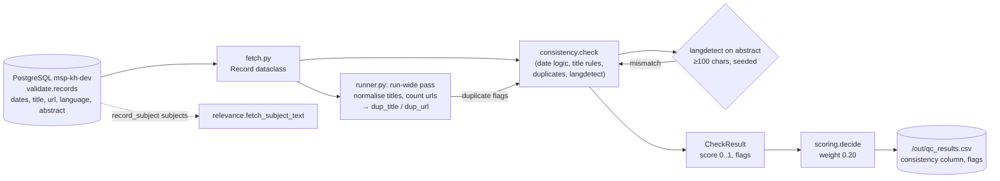

# Consistency

> TOR p. 25: the Knowledge Hub's quality assurance must validate **consistency** of knowledge
> objects. Scored by `qc.runner` with weight **0.20**.

## What it is

Consistency asks: *does the record contradict itself or the rest of the corpus?* Completeness
looks at fields in isolation; consistency looks at how they relate:

- **Date logic** — a publication date in the future, content created after it was published, an
  updated timestamp before creation, a temporal range whose end precedes its start are all
  impossible or suspicious orderings.
- **Title sanity** — under 10 characters, over 250, or ALL CAPS is almost always a harvesting or
  cataloguing artefact.
- **Duplicates** — two records with the same normalised title or the same URL are likely the same
  object harvested twice; a hub that shows both wastes the reviewer's time.
- **Language agreement** — the abstract's detected language differs from the declared `language`
  field, which breaks search, filtering and any language-based presentation.

## How we achieve it

Code: [`qc/checks/consistency.py`](../qc/checks/consistency.py) —
`check(record, dup_title, dup_url)`.

Same penalty model as completeness: start at 1.0, subtract per problem (floor 0). No condition is
currently graded **major** — consistency issues alone never block publish, they only pull the
overall score down.

### Penalty table

| Condition | Flag | Penalty |
|---|---|---|
| `publication_date` in the future | `publication_in_future` | −0.25 |
| `language` field ≠ `langdetect` of the abstract (abstract ≥ 100 chars) | `language_mismatch` | −0.20 |
| title under 10 chars (`MIN_TITLE_CHARS`) | `title_too_short` | −0.20 |
| `temporal_end` before `temporal_start` | `temporal_end_before_start` | −0.15 |
| duplicate normalised title (across the whole run) | `duplicate_title` | −0.15 |
| duplicate `url` (across the whole run) | `duplicate_url` | −0.15 |
| `resource_creation_date` after `publication_date` | `created_after_published` | −0.10 |
| `resource_updated_date` before `resource_creation_date` | `updated_before_created` | −0.10 |
| title over 250 chars (`MAX_TITLE_CHARS`) | `title_too_long` | −0.10 |
| title is all caps | `title_all_caps` | −0.05 |

Details worth knowing:

- **Language detection** uses `langdetect` with `DetectorFactory.seed = 0` so results are
  deterministic across runs. Only 15 language names are mapped (`LANG_CODES` in `config.py`);
  records in unmapped languages are skipped rather than flagged. Detection is skipped for
  abstracts under 100 chars, where it is unreliable.
- **Duplicates are run-wide.** `runner.py` builds `Counter` maps of
  `re.sub(r"\W+", " ", title.lower())` and of `url` over *all* records before scoring, then passes
  `dup_title` / `dup_url` booleans into the check. They therefore only work when scoring the full
  corpus, not with `--limit`.
- **Nothing is waived.** Consistency problems are record-level; a systemic gap in a source does
  not make a future publication date acceptable.

### Output

A `CheckResult` with `dimension="consistency"`, score 0..1 and flags; written to the
`consistency` column of `out/qc_results.csv`.

## Data flow

## Current results

From `profile_report.md` and `docs/FINDINGS.md` (25,129 records):

- Mean consistency score: **0.986** — the strongest dimension; the corpus is internally coherent.
- Dates: 42 publications in the future, 78 created after published, 2 temporal end before start.
- Duplicates: 205 groups share a normalised title, 122 groups share a URL, **0** duplicate
  identifiers.
- Titles: 82 under 10 chars, 38 over 250 chars, 205 all caps.
- Language: 88% English; **880 records** whose abstract language does not match the `language`
  field.

## What remains

- [ ] **Exact-match duplicates only.** `norm_title` collapses case and punctuation, but
      "Soil atlas of Europe" vs. "The soil atlas of Europe" or a translated/updated title of the
      same item are not caught. 205 title groups are the *lower* bound of true duplication.
- [ ] **Near-duplicate URLs** (http vs https, trailing slash, query params, encoded vs plain —
      note the percent-encoded `access_url` defect) are treated as different URLs.
- [ ] **Language coverage is partial.** 15 mapped names; records whose `language` is an ISO code
      or an unmapped name get no check at all, and 880 known mismatches still need a decision
      (wrong field vs. wrong abstract).
- [ ] **No major flag exists for this dimension.** A duplicate or a future publication date never
      blocks publish on its own — only via the score.
- [ ] **Cross-field consistency is not checked**, e.g. `resource_type` vs. title/abstract, dates
      vs. the project period, `raw_metadata` JSON vs. the promoted columns.
- [ ] `--limit` runs silently skip duplicate detection (by design), which can mislead when
      comparing runs.

## Suggestions

1. **Fuzzy duplicate detection.** Block on normalised title tokens (or a trigram/MinHash
   signature), then compare within blocks. Report duplicate *clusters* with a suggested primary
   record instead of pairwise flags — that is what the reviewer actually needs.
2. **Normalise URLs before counting** (`urllib.parse`, lowercase host, strip trailing slash, drop
   tracking params) and compare `records.url` against `distributions.access_url` too. This also
   makes the percent-encoded defect visible as an inconsistency, not only as a link failure.
3. **Promote one or two conditions to major**, e.g. `duplicate_url` between two records with
   different titles, or `publication_in_future` beyond a small grace window — the current
   "nothing is major" rule means consistency can never by itself stop a bad record.
4. **Widen `LANG_CODES`** to every distinct `language` value in the corpus (a one-line report
   from `qc.profile`), and consider flagging *unmapped* languages rather than skipping them.
5. **Add a `raw_metadata` cross-check**: if the JSON blob disagrees with the promoted column
   (title, license, date), the harvester mapping is wrong — a cheap, high-value consistency test
   that catches bugs before they become data-quality trends.

See also: [`COMPLETENESS.md`](COMPLETENESS.md), [`CREDIBILITY.md`](CREDIBILITY.md),
[`RELEVANCE.md`](RELEVANCE.md), [`ACCURACY.md`](ACCURACY.md).
