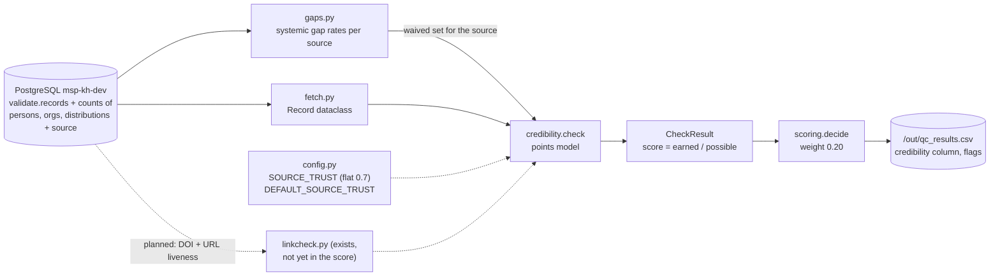

# Credibility

> One of the five quality dimensions required by the TOR (p. 25). Scored with weight **0.20**.
>
> **In one sentence:** *"Can a user trust this record — who made it, under what terms, and can
> it be found again?"*

## What it is (plain words)

Imagine two records, both complete and consistent. One says: *"Published by FAO, CC BY license,
link works."* The other says: *"Unknown author, no license, no reliable link."* Both are
*complete sentences* — but you would trust the first one much more.

Credibility is that judgement: **should the hub's users believe this record?** It looks at four
simple signals:

| Signal | The question it answers |
|---|---|
| source trust | do we trust where this record was harvested from? |
| attribution | is there a person or organization accountable for it? |
| license | are the reuse terms written down? |
| link | can anyone re-check or re-open the source? |

**Analogy:** like checking a recipe — known cook, clear ingredients list, published in a real
magazine? Then you can trust it. Anonymous, no license, broken link? Be careful.

## How we check it

Code: [`qc/checks/credibility.py`](../qc/checks/credibility.py) — `check(record, waived)`.

### The idea in plain words

Unlike completeness (which *subtracts* points), credibility **earns** points — like collecting
stamps on a card. There are stamps available for: coming from a trusted source, having an author,
having a license, and having a link. The score is simply:

> **score = stamps earned ÷ stamps available**

And the clever part: if a field is missing from an entire source (a harvester bug), that stamp is
**removed from both sides** of the division — neither earned nor available — so the record is not
punished for a problem it cannot fix.

The check is deliberately **offline** — no internet calls during scoring — so the full run of
25,129 records stays fast and reproducible. Link checking exists as a separate job but is **not
part of the score yet**.

### The exact rules (technical)

| Component | Possible points | Earned when | Flag if not |
|---|---|---|---|
| source trust | 0.5 | always: `0.5 × SOURCE_TRUST[source]` | — |
| attribution | 0.2 | at least one person **or** organization linked | `no_attribution` |
| license | 0.15 | `license` non-empty | `no_license` |
| url / distribution | 0.15 | `url` set **or** ≥1 distribution | — |

`score = earned / possible`, capped at 1.0.

**Important current state:** `SOURCE_TRUST` in [`qc/config.py`](../qc/config.py) is an **empty
dict** — every source gets the default 0.7. So the trust component is identical for every record
and currently says nothing about which source is better (this is decision #3 in
[`TEAM_QUESTIONS.md`](TEAM_QUESTIONS.md)).

### Waivers (same smart rule as completeness)

[`qc/gaps.py`](../qc/gaps.py) provides the waiver set: if `license`, `url` or `person_org` is
missing in 80%+ of a source's records (source ≥ 50 records), that component disappears from
*both* earned and possible points. Example: for an impact4soil record only source trust and the
URL component remain — the score reflects what that source can actually deliver.

### Output

A `CheckResult` with `dimension="credibility"` and flags; written to the `credibility` column of
`out/qc_results.csv`.

## Data flow

Reading the diagram in plain words: the record and its relationship counts come out of the
database, the source-gap waivers arrive alongside them, the source-trust setting is applied from
config, the points are tallied into a score, and that flows into the final decision and the CSV —
while the link checker (dotted line) is *planned* but not yet connected.

## What we found

(from `docs/FINDINGS.md`, run3 and run4, 25,129 records; this dimension is identical in both runs)

- Average credibility score: **0.768 out of 1** — but note it mostly mirrors attribution and
  license presence, not any real trust judgement.
- Because `SOURCE_TRUST` is flat at 0.7 for all 14 sources, the trust part contributes **exactly
  the same to every record** — today the score says almost nothing about which source is more
  credible.
- Common flags: `no_license` 6,282 and `no_author_or_org` 2,458 (after waivers). Overall, the
  license is missing in 77.5% of records and in 82–100% of 12 of 14 sources.
- Link evidence exists but is unused: of 22,872 testable URLs, **92.7% work**; 78 broken, 78
  restricted, 868 time out; DOIs are healthy (only 14 failures).

## What is not finished

- **Source trust is not configured.** `SOURCE_TRUST` is empty — waiting on the team to rate the
  14 sources high / medium / low.
- **Link and DOI liveness are not in the score** (the biggest gap). Where it will count is still to be decided: the current plan puts it under accuracy ([`ACCURACY.md`](ACCURACY.md)), so credibility should not count it too. The checker and its results
  files already exist; wiring them in is step 3 of [`NEXT_STEPS.md`](NEXT_STEPS.md).
- **License is presence-only.** `CC BY` (open) and `Wiley Online Library User Agreement`
  (restrictive) earn the same 0.15 points.
- **Attribution is presence-only.** One unidentified name earns full points; the database already
  has `ORCID` (persons) and `ROR` (organizations) identifier columns — never read.
- **No publisher/venue signal.** Predatory journals, retracted papers or non-authoritative hosts
  are not distinguished.
- **No manual-review input** — only 3 approved / 1 disapproved records exist, far too few to
  calibrate anything.

## Suggestions

1. **Get the trust ratings into `config.SOURCE_TRUST`.** Even a crude split (high 0.9 / medium 0.7
   / low 0.4) would make this dimension meaningful immediately — it is the cheapest improvement
   available.
2. **Add link results to the score once, under accuracy** (`NEXT_STEPS.md` §3), not in both dimensions: per-record share of working links,
   with timeouts and "restricted" responses counted as *unknown, not failed* until we confirm
   which hosts are truly dead. This turns "offline guesses" into evidence.
3. **Grade the license, don't just count it:** open licenses score full, publisher agreements
   score as "unknown", empty stays missing.
4. **Use ORCID/ROR:** full points for an attribution that carries an ORCID/ROR identifier,
   partial for a bare name — a real trust signal already sitting in the database.
5. **Add DOI checks for articles** (Crossref lookup: is the DOI real? retracted? does the title
   match?) — this would cover the 10,965 journal articles and can reuse the resumable style of
   `linkcheck.py`.
6. **Reconsider the 0.5 weight on source trust** — half the score currently comes from a value
   that is the same for everyone; until ratings exist, attribution and license should do more of
   the work.

## One-sentence summary

> Credibility collects "trust stamps" — trusted source, author, license, working link — and
> divides earned by available stamps, but until the team rates the sources and the link checker
> joins the score, it mostly tells us *who filled in the form*, not *whether to believe it*.

See also: [`COMPLETENESS.md`](COMPLETENESS.md), [`CONSISTENCY.md`](CONSISTENCY.md),
[`ACCURACY.md`](ACCURACY.md), [`RELEVANCE.md`](RELEVANCE.md).
