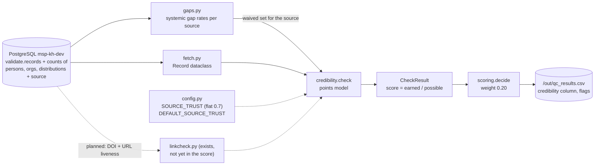

# Credibility

> TOR p. 25: the Knowledge Hub's quality assurance must validate **credibility** of knowledge
> objects before they are made available. Scored by `qc.runner` with weight **0.20**.

## What it is

Credibility asks: *should the hub's users believe this record?* It is the dimension about
**trust**: who stands behind the object, under what terms it may be used, whether it can be
located again, and whether it comes from a source we consider reputable.

Three signals are evaluated:

| Signal | Question it answers |
|---|---|
| source trust | do we trust this harvester/source at all? |
| attribution (person or organization) | is there someone accountable for this object? |
| license | are the reuse terms explicit? |
| url / distribution | can anyone re-check or re-open the source? |

Credibility is intentionally kept **offline** — no network calls in the scoring run — so the
full 25k-record pass stays fast and reproducible. Link and DOI liveness exist as a separate job
(`qc/linkcheck.py`) and are *not yet* part of the score.

## How we achieve it

Code: [`qc/checks/credibility.py`](../qc/checks/credibility.py) — `check(record, waived)`.

Unlike completeness/consistency (penalty model), credibility is a **points model**: earned points
over possible points, so the score is always 0..1 and waived components are removed from *both*
numerator and denominator (a harvester-level gap neither helps nor hurts).

### Points

| Component | Possible | Earned when | Config |
|---|---|---|---|
| source trust | 0.5 | always: `0.5 × SOURCE_TRUST[source]` | `DEFAULT_SOURCE_TRUST = 0.7`, `SOURCE_TRUST = {}` |
| attribution | 0.2 | at least one person **or** organization linked | flag `no_attribution` if not |
| license | 0.15 | `license` non-empty | flag `no_license` if not |
| url / distribution | 0.15 | `url` set **or** ≥1 distribution | — |

`score = earned / possible`, capped at 1.0.

### Source-aware waivers

The same [`qc/gaps.py`](../qc/gaps.py) waiver set as completeness: if `license`, `url` or
`person_org` is a systemic gap for the record's source (≥80% missing, source ≥50 records), that
component is dropped from earned *and* possible points. Example: for an impact4soil record only
source trust and the URL component remain, so the score reflects what that source can actually
deliver.

### Output

A `CheckResult` with `dimension="credibility"` and flags; written to the `credibility` column of
`out/qc_results.csv`.

## Data flow

## Current results

From `docs/FINDINGS.md` (run3, 25,129 records):

- Mean credibility score: **0.768** — the second-weakest dimension, and mostly a mirror of
  attribution/license presence rather than any real trust judgement.
- Because `SOURCE_TRUST` is flat at 0.7 for all 14 sources, the trust component contributes
  exactly the same to every record — **the score currently says almost nothing about which source
  is more credible**.
- Common flags: `no_license` 6,282 and `no_author_or_org` 2,458 (after waivers); in the profile,
  license is missing in 77.5% overall and 82–100% in 12 of 14 sources.
- Link evidence exists but is unused: of 22,872 testable URLs, 92.7% are ok; 78 broken, 78
  restricted, 868 timeout; DOIs are healthy (14 failures).

## What remains

- [ ] **Source trust is not configured.** `SOURCE_TRUST` in `config.py` is an empty dict —
      decision #3 in `docs/TEAM_QUESTIONS.md` (who rates the 14 sources high/medium/low?).
- [ ] **Link/DOI liveness is not in the score** (the main gap). The checker, the cleaned first
      pass (`out/link_results_clean.csv`), the decoded sample and the 30 s retry all exist;
      integrating them is `NEXT_STEPS.md` step 3.
- [ ] **License is presence-only.** `Elsevier TDM`, `Wiley ... User Agreement`, `CC BY` and
      `CC0` all earn the same 0.15; a publisher's text-and-data-mining terms is not the same kind
      of permission as an open license.
- [ ] **Attribution is presence-only.** One unidentified person earns full 0.2; ORCID
      (`persons.orcid`) and ROR (`organizations.ror_identifier`) columns exist in the schema but
      are never read.
- [ ] **No publisher/venue signal.** Journal articles from predatory or irrelevant venues,
      retracted papers, or non-authoritative hosts are not distinguished.
- [ ] **No manual-review input.** The 3 approved / 1 disapproved records are too few to inform
      anything.

## Suggestions

1. **Get the trust ratings and put them in `config.SOURCE_TRUST`** (decision #3). Even a crude
   high=0.9 / medium=0.7 / low=0.4 split would make this dimension meaningful immediately; it is
   the cheapest available improvement.
2. **Integrate link results as planned** (`NEXT_STEPS.md` §3): per-record share of `ok` links,
   with `timeout` and `restricted` treated as *unknown, not failed* until the dead-host question
   is settled; keep the percent-encoded defect as its own flag. This turns "offline signals only"
   into evidence.
3. **Score license by class, not presence.** Map known values (CC0/CC BY/CC BY-SA/... = open;
   publisher agreements = restricted/unknown) and award full points only for open or explicitly
   public-domain terms; keep `no_license` for empty.
4. **Use ORCID/ROR as confidence**: full points for attributed names with an ORCID/ROR identifier,
   partial for a bare name — a real, offline credibility signal already sitting in the database.
5. **Add DOI-level checks for articles**: Crossref lookup (retraction flag, type, container
   title) for the ~10,965 journal articles would add a genuinely authoritative signal; it can run
   in the same resumable style as `linkcheck.py`.
6. **Reconsider the 0.5 weight on source trust.** Half the score currently comes from a value
   that is identical for every record; until ratings exist, consider lowering it so attribution
   and license do the work.

See also: [`COMPLETENESS.md`](COMPLETENESS.md), [`CONSISTENCY.md`](CONSISTENCY.md),
[`ACCURACY.md`](ACCURACY.md), [`RELEVANCE.md`](RELEVANCE.md).
