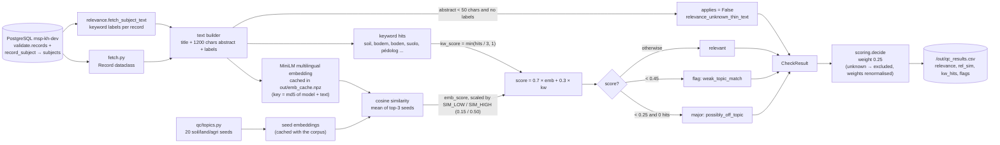

# Relevance

> One of the five quality dimensions required by the TOR (p. 25). Scored with weight **0.25**
> (tied for the highest). This is the dimension where the TOR's *"automated validation using text
> mining / NLP"* is actually implemented.
>
> **In one sentence:** *"Is this record actually about soil, land or agriculture — or is it
> something completely different?"*

## What it is (plain words)

A record can be complete, consistent and credible and still be **worthless** in a soil Knowledge
Hub — for example a perfectly described paper about *optical metasurfaces* or the *gut
microbiome*. Those really appear in our data (mostly from the openaire source).

Relevance answers: **does this belong in the hub?**

Unlike the other checks, this cannot be answered by looking at fields — it is a question about
**meaning**. So we use AI/NLP, exactly as the TOR suggests, in two complementary ways:

1. **An embedding model (the smart way).** We convert the record's text and a list of
   soil/agriculture *topic examples* into numbers (vectors), then measure how close they are.
   Close = relevant. This works across 15+ languages because the model is multilingual.
2. **Keyword matching (the simple, transparent way).** Does the text contain soil-related words —
   *soil, bodem, boden, suolo, pédologique* … ? Easy for anyone to understand and verify.

The two are blended, and the result raises one of two flags:
`possibly_off_topic` (**serious** — stops automatic publishing) or `weak_topic_match` (minor).

**Analogy:** imagine showing each record to someone and asking *"which of these 20 topic sheets
does it belong to?"* — the embedding does that instantly for 25,000 records; the keywords are the
sticky notes.

## How we check it

Code: [`qc/checks/relevance.py`](../qc/checks/relevance.py) (batch API),
topics and keywords in [`qc/topics.py`](../qc/topics.py), settings in
[`qc/config.py`](../qc/config.py).

### The idea in plain words

1. Take the record's text: **title + start of the abstract + keywords**.
2. Ask the model: *"how close is this to our 20 soil/land/agriculture topic examples?"*
3. Mix in the keyword count as a sanity check (70% model, 30% keywords).
4. If the result is very low **and** no keyword matched → **`possibly_off_topic` (serious)**.
   If it is moderately low → **`weak_topic_match`**.
5. Special case: records with almost no text (title "Video", empty abstract) are marked
   **"unknown"** instead of off-topic — an AI model cannot judge a text that isn't there, and a
   human should look instead.

### The exact steps (technical)

1. **Text assembly.** `title` + first **1,200** chars of `abstract` + the record's **subject
   labels** (`record_subject` → `subjects.label`, up to 300 chars, fetched separately by
   `fetch_subject_text()`).
2. **Embedding model.** `paraphrase-multilingual-MiniLM-L12-v2` on CPU,
   `max_seq_length = 256`, normalised vectors. Multilingual because the corpus is 88% English but
   also German, Italian, French, Dutch and 10 more languages.
3. **Caching.** Each text is keyed by `md5(model_name | text)` and stored in
   `out/emb_cache.npz`. Changing cut-offs or keywords reruns in minutes — only *new* texts get
   re-embedded.
4. **Similarity.** Cosine similarity against the **20 topic seeds**; take the **mean of the 3
   best-matching seeds** (one strong match is enough, while a record matching only one narrow
   seed scores lower).
5. **Score mapping.**
   - `emb_score = clip((sim − SIM_LOW) / (SIM_HIGH − SIM_LOW), 0, 1)` with `SIM_LOW = 0.15`,
     `SIM_HIGH = 0.50` (chosen from the observed distribution, **not** from labeled data).
   - `kw_score = min(hits / 3, 1)` — three or more keyword hits saturate it.
   - `score = 0.7 × emb_score + 0.3 × kw_score`.
6. **Flags.**
   - `score < 0.25` (`OFFTOPIC_MAX`) **and zero keyword hits** → **major** `possibly_off_topic`.
   - `score < 0.45` (`WEAK_TOPIC_MAX`) → flag `weak_topic_match`.
7. **Thin-text exemption.** Abstract under 50 chars **and** no subject labels → the result is
   stored with `applies=False` and flag `relevance_unknown_thin_text`: relevance is **unknown**,
   not off-topic (added after run3, which produced false flags on records like "Video").

### Output

`CheckResult("relevance", score, flags, major)` per record, plus diagnostics `sim` and `hits`
(columns `rel_sim`, `kw_hits` in `out/qc_results.csv`). Embeddings are computed in one batch for
all records — unlike the other four checks, which run record by record.

## Data flow

Reading the diagram in plain words: the record and its keyword labels come out of the database;
they are joined into one text; the text and the 20 topic examples are turned into numbers and
compared; the keywords are counted; the two signals blend into one score; the score decides
"off-topic / weak / fine" — or "unknown" if the text was too short — and the result flows into
the final decision and the CSV report.

## What we found

(from `docs/FINDINGS.md`, run4, 25,129 records)

- Average relevance score: **0.685 out of 1** — the weakest dimension, which is expected: it is
  the only one making a *judgement* rather than counting fields.
- Flags: **1,568 `possibly_off_topic`** (down from 1,830 after the thin-text fix) and **2,957
  `weak_topic_match`**.
- **openaire dominates**: 1,211 of the run3 off-topic flags; spot checks show genuinely unrelated
  papers (optical metasurfaces, inductors, gut microbiome, polymer membranes).
- **eufarmbook (12% flagged)** is livestock, poultry, cheese traceability, animal breeding —
  agriculture, but not soil. Whether that is in scope is **decision #1** in
  [`TEAM_QUESTIONS.md`](TEAM_QUESTIONS.md).
- **A real bug was caught:** French soil maps ("Carte pédologique …") were wrongly flagged
  because the keyword list lacked accented forms; adding them took data.europa.eu from 9% to 2%
  off-topic.
- Thin-text fix: 586 records (mostly openaire 326, fao 177) now carry
  `relevance_unknown_thin_text`; 585 of them went to review instead of being called off-topic.

## What is not finished

- **The cut-offs are guesses.** `SIM_LOW/HIGH` (0.15/0.50), `OFFTOPIC_MAX` (0.25),
  `WEAK_TOPIC_MAX` (0.45) and the 0.7/0.3 blend come from a handful of samples, not labeled
  data. The 60-record blind workbook `out/labeling_sample.xlsx` is ready and waiting
  ([`NEXT_STEPS.md`](NEXT_STEPS.md) §0) — when labels return, a small script compares them with
  our decisions and proposes better cut-offs.
- **The scope question is open** — is food/livestock content in the Knowledge Hub? Until the
  team answers, the eufarmbook flags cannot be called right or wrong.
- **The 20 topic examples are hand-written.** They *are* the definition of scope; there are no
  "negative" examples (topics we definitely do *not* want), so the model can only pull towards
  the topic, never actively away from it.
- **The keyword list is hand-maintained** — the accented-French bug proved it; other languages
  may have the same hidden gap.
- **Records with almost no text** are exempted, not solved — they still need a human.
- **Off-topic rates differ wildly by source** (openaire 19% vs islandr 1%) — worth checking
  whether that is source quality or a check artefact.

## Suggestions

1. **Calibrate first, tune later — in that order.** Use the labeled 60 records to plot
   precision/recall against `OFFTOPIC_MAX` / `WEAK_TOPIC_MAX` and pick the operating point (the
   team will likely want *high precision* on `possibly_off_topic`, since it blocks publishing).
   Everything else here is secondary.
2. **Add negative seeds** — topics the hub explicitly does *not* want (optics, medicine,
   engineering) make the contrast sharper and reduce both false accepts and false rejects.
3. **Mine seeds from the data we already have.** The 20,147 subject labels contain the hub's own
   vocabulary: cluster them, use representative soil/land/agri labels as extra seeds, and use the
   rest to sanity-check scope.
4. **Make keywords data-driven too.** Derive candidate keywords from subject labels and
   high-scoring records per language, then keep a human-curated allowlist — this prevents the
   next missing-accent bug.
5. **Show the reviewer *why*.** Add the best-matching topic example's name to the CSV (we already
   store `rel_sim` and `kw_hits`) — one extra column builds a lot of trust in the flag.
6. **Give thin-text records a second, cheap signal** — subject labels alone, or resource type +
   title pattern — instead of sending them all to review.

## One-sentence summary

> Relevance converts each record's text into numbers and measures how close it is to 20
> soil/agriculture topic examples (70%) plus a multilingual keyword check (30%) — it flagged
> ~1,568 records as probably off-topic, but its cut-offs are still guesses until a domain expert
> labels the ready-made sample.

See also: [`COMPLETENESS.md`](COMPLETENESS.md), [`CONSISTENCY.md`](CONSISTENCY.md),
[`CREDIBILITY.md`](CREDIBILITY.md), [`ACCURACY.md`](ACCURACY.md).
