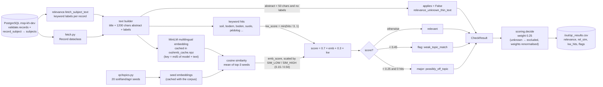

# Relevance

> TOR p. 25: the Knowledge Hub's quality assurance must validate **relevance** of knowledge
> objects, using automated validation such as text mining / NLP. This is the dimension where the
> NLP requirement is actually implemented. Scored with weight **0.25** (tied for the highest).

## What it is

Relevance asks: *is this record about soil, land or agriculture at all — i.e. inside the scope of
the Knowledge Hub?* A perfectly complete, consistent, credible record about optical metasurfaces
or gut microbiomes is still worthless in a soil Knowledge Hub.

Because relevance is a judgement about *meaning*, it cannot be answered with field checks. We use
NLP, exactly as the TOR suggests:

1. **Embedding similarity** — map the record's text and a set of hand-written topic seeds into the
   same multilingual vector space and measure how close the record is to the topic profile.
2. **Keyword hits** — a transparent, explainable backstop: does the text contain soil-related
   terms in any of the harvested languages?

The two are combined, and the result drives two flags: `possibly_off_topic` (**major** — blocks
automatic publish) and `weak_topic_match` (minor).

## How we achieve it

Code: [`qc/checks/relevance.py`](../qc/checks/relevance.py) (batch API),
seeds and keywords in [`qc/topics.py`](../qc/topics.py), cut-offs in
[`qc/config.py`](../qc/config.py).

This check is **batch-based** (`score_all(records) -> {record_id: CheckResult}`), unlike the other
four which are per-record — one model load and one matrix operation score the whole corpus.

### Step by step

1. **Text assembly.** `title` + first **1,200** chars of `abstract` + the record's **subject
   labels** (`record_subject` → `subjects.label`, up to 300 chars, fetched separately by
   `fetch_subject_text()`).
2. **Embedding.** `paraphrase-multilingual-MiniLM-L12-v2` on CPU, `max_seq_length = 256`,
   normalised vectors. Multilingual because the corpus is 88% English but includes German,
   Italian, French, Dutch and 10 more languages.
3. **Caching.** Each text is keyed by `md5(model_name | text)` and stored in
   `out/emb_cache.npz`. Changing cut-offs, weights or keywords reruns in minutes; only *new* texts
   are embedded.
4. **Similarity.** Cosine similarity against the **20 topic seeds**; take the **mean of the 3
   best-matching seeds** (so one strong thematic match is enough, while a record matching only one
   narrow seed scores lower).
5. **Score mapping.**
   - `emb_score = clip((sim − SIM_LOW) / (SIM_HIGH − SIM_LOW), 0, 1)` with `SIM_LOW = 0.15`,
     `SIM_HIGH = 0.50` (set from the observed distribution, **not** from labels).
   - `kw_score = min(hits / 3, 1)` — three or more keyword hits saturate it.
   - `score = 0.7 × emb_score + 0.3 × kw_score`.
6. **Flags.**
   - `score < 0.25` (`OFFTOPIC_MAX`) **and zero keyword hits** → **major** `possibly_off_topic`.
   - `score < 0.45` (`WEAK_TOPIC_MAX`) → flag `weak_topic_match`.
7. **Thin-text exemption.** If the abstract is under 50 chars *and* there are no subject labels
   (e.g. title "Video"), the embedding cannot mean anything — the result is stored with
   `applies=False` and flag `relevance_unknown_thin_text`: relevance is **unknown**, not
   off-topic. Added after run3 because it produced false off-topic flags.

### Output

`CheckResult("relevance", score, flags, major)` per record, plus diagnostics `sim` and `hits`
(columns `rel_sim`, `kw_hits` in `out/qc_results.csv`).

## Data flow

## Current results

From `docs/FINDINGS.md` (run4, 25,129 records):

- Mean relevance: **0.685 — the weakest dimension**, which is expected: it is the only one
  making a semantic judgement.
- Flags: **1,568 `possibly_off_topic`** (down from 1,830 after the thin-text fix) and 3,043
  `weak_topic_match`.
- **openaire dominates**: 1,211 of the 1,830 run3 off-topic flags; spot checks show genuinely
  unrelated papers (optical metasurfaces, inductors, gut microbiome, polymer membranes).
- **eufarmbook (12% flagged)** is livestock, poultry, cheese traceability, animal breeding:
  agriculture, but not soil — in scope or not is **decision #1** in `docs/TEAM_QUESTIONS.md`.
- **A real bug was caught:** French soil maps ("Carte pédologique ...") were flagged because the
  keyword list lacked accented forms; adding them took data.europa.eu from 9% to 2% off-topic.
- Thin-text fix: 586 records (mostly openaire 326, fao 177) now carry
  `relevance_unknown_thin_text`; 585 of them went to review rather than being called off-topic.

## What remains

- [ ] **The cut-offs are guesses.** `SIM_LOW/HIGH` (0.15/0.50), `OFFTOPIC_MAX` (0.25),
      `WEAK_TOPIC_MAX` (0.45) and the 0.7/0.3 blend were set from a handful of samples, not from
      labeled data. The 60-record blind workbook `out/labeling_sample.xlsx` is ready and waiting
      (`NEXT_STEPS.md` §0): when labels return, write the calibration script (precision/recall per
      cut-off, propose new values).
- [ ] **Scope decision open** — is food/livestock content in the Knowledge Hub? Until the team
      answers, the eufarmbook flags cannot be classified as true or false positives.
- [ ] **Seeds are hand-written.** 20 sentences in `qc/topics.py` represent the whole scope
      definition; no negative (out-of-scope) seeds exist, so the model can only pull towards the
      topic, never actively away from it.
- [ ] **Keyword list is not exhaustive.** The accented-French bug proved it: it is maintained by
      hand and other languages/vocabularies (e.g. Polish, Romanian soil terms) may be missing.
- [ ] **Title-only and very short records** are handled by exemption, not scored — they still
      need a human or a different signal.
- [ ] **No per-source evaluation.** Off-topic rates differ wildly by source (openaire 19% vs.
      islandr 1%) — worth reviewing whether that is source quality or a check artefact.

## Suggestions

1. **Calibrate first, tune later — in that order.** Use the labeled 60 records to plot
   precision/recall against `OFFTOPIC_MAX` / `WEAK_TOPIC_MAX` and pick the operating point (the
   team likely prefers high precision on `possibly_off_topic`, since it blocks publish). Everything
   else in this list is secondary.
2. **Add negative seeds.** Topics the hub explicitly does *not* want (optics, medicine,
   microbiome, pure engineering) make the similarity contrast sharper and reduce false accepts as
   well as false rejects.
3. **Mine the seeds from the corpus itself.** The 20,147 `subjects` labels already contain the
   hub's own vocabulary: cluster them, take representative soil/land/agri labels as extra seeds,
   and use the rest to sanity-check scope. It is data you already have.
4. **Make keywords data-driven too.** Derive candidate keywords from subject labels and
   high-scoring records (per language), then keep a human-curated allowlist — this prevents the
   next missing-accent bug.
5. **Record the raw evidence in the CSV** (already partly done via `rel_sim` / `kw_hits`): add
   the best-matching seed name so a reviewer can see *why* a record was flagged — one column,
   big trust win.
6. **Consider a second, cheap signal for thin-text records**: subject labels alone, or the
   resource type + title pattern, instead of leaving them entirely to review.

See also: [`COMPLETENESS.md`](COMPLETENESS.md), [`CONSISTENCY.md`](CONSISTENCY.md),
[`CREDIBILITY.md`](CREDIBILITY.md), [`ACCURACY.md`](ACCURACY.md).
