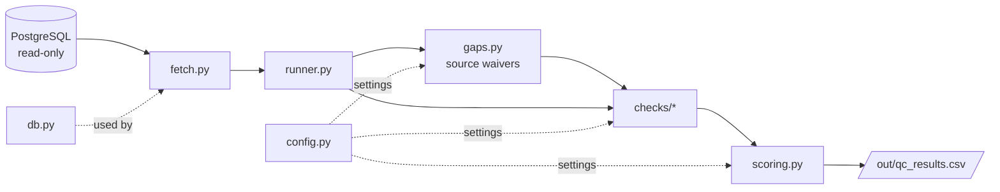
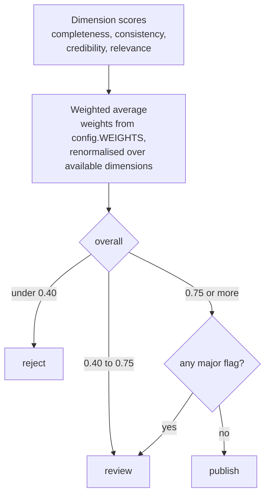

# qc package

The code that reads records, runs the checks, scores them and writes results.
Project overview and full diagrams: [`../README.md`](../README.md). Individual checks: [`checks/README.md`](checks/README.md).

## Module flow

## Files

| File | Role |
|---|---|
| `db.py` | Connection from `DB_*` env vars (loaded from `.env` at runtime), read-only |
| `config.py` | Weights, thresholds, source trust, waiver settings, relevance cut-offs |
| `models.py` | `Record` and `CheckResult` dataclasses |
| `fetch.py` | Loads records plus counts of persons, organizations, subjects, distributions, and source |
| `gaps.py` | Detects fields systematically missing per source (waivers) |
| `topics.py` | Soil/land/agri topic seeds and keywords for relevance |
| `checks/` | One module per dimension |
| `scoring.py` | Weighted score to publish / review / reject |
| `runner.py` | Runs everything, writes `out/qc_results.csv` |
| `linkcheck.py` | URL and DOI liveness checker (separate, resumable job) |
| `source_report.py` | Per-source gap report (`out/source_gaps.md`) |
| `discover.py`, `profile.py` | Schema discovery and data profiling reports |

Each check returns a `CheckResult`: a `score` in 0..1, `flags` (minor issues that lower the score) and
`major` (serious issues that block automatic publish).

## Scoring (`scoring.py`)

Weights: completeness 0.25, consistency 0.20, credibility 0.20, relevance 0.25. Accuracy (0.10) joins once link
results are added.

## Source-aware scoring (`gaps.py`)
A field missing in at least `SYSTEMIC_THRESHOLD` (80%) of a source's records is a harvester-level gap. For
sources with at least `MIN_SOURCE_SIZE` (50) records it is waived: not penalised per record in completeness,
and dropped from the credibility score. Waivable: license, url, person_org, keywords, dates. Abstract length
and the consistency checks are never waived. The gaps stay visible in `out/source_gaps.md`
(`python -m qc.source_report`) and should be fixed in the harvesters.

## Tuning
Edit `config.py`: weights, thresholds, `SOURCE_TRUST`, length limits, `SIM_LOW` / `SIM_HIGH`,
`OFFTOPIC_MAX`, `WEAK_TOPIC_MAX`. Thresholds are untuned guesses until labeled records exist.

## Adding a check
Create `checks/<name>.py` with `check(record) -> CheckResult`, add the weight to `config.WEIGHTS`, and call it in
`runner.py`. (`relevance.py` is batch-based: `score_all(records)`.)

## Output (`out/qc_results.csv`)
See [`../out/README.md`](../out/README.md).
