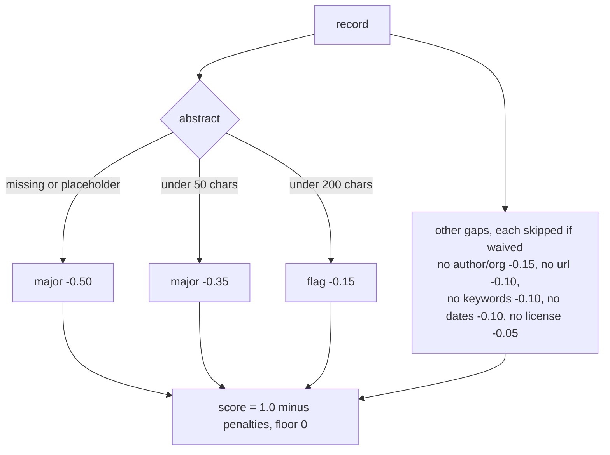
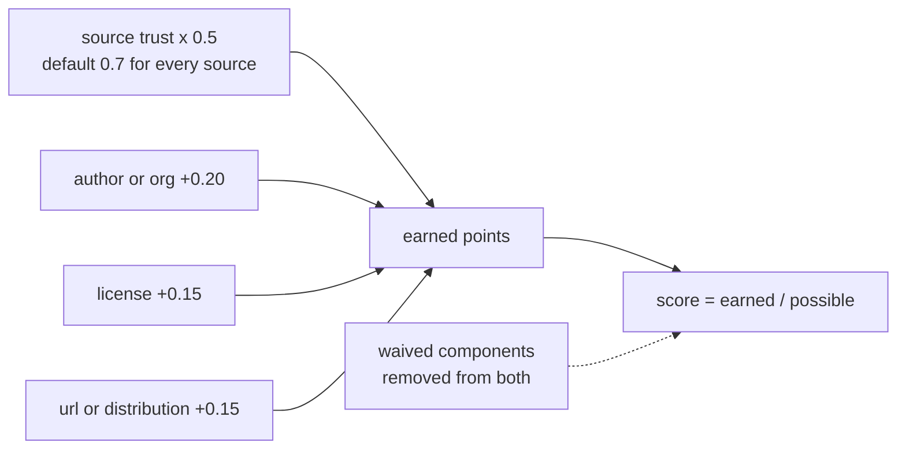
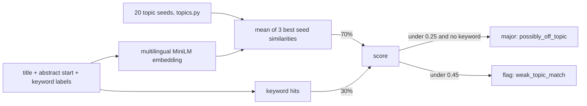

# checks

One module per quality dimension. Each returns a `CheckResult` (`score` 0..1, `flags`, `major`).
Source-aware: completeness and credibility accept a `waived` set (see `../gaps.py`).

| Module | Dimension | Signature |
|---|---|---|
| `completeness.py` | Completeness | `check(record, waived)` |
| `consistency.py` | Consistency | `check(record, dup_title, dup_url)` |
| `credibility.py` | Credibility (offline signals) | `check(record, waived)` |
| `relevance.py` | Relevance | `score_all(records)` (batch, embeddings) |
| `accuracy.py` | Accuracy (spatial WKT plausibility; returns None when no spatial value) | `check(record)` |
| link liveness | not in the score yet; see `../linkcheck.py` | |

## completeness

## consistency

| Condition | Penalty |
|---|---|
| Publication date in the future | 0.25 |
| Title under 10 chars | 0.20 |
| Abstract language differs from `language` field (`langdetect`, abstract of 100+ chars) | 0.20 |
| Temporal end before start | 0.15 |
| Duplicate normalized title / duplicate URL | 0.15 each |
| Created after published; updated before created | 0.10 each |
| Title over 250 chars | 0.10 |
| Title all caps | 0.05 |

Duplicates are detected across the whole run, so they only work when scoring all records.

## credibility

DOI and URL liveness are not part of this score yet.

## relevance

Embeddings are cached in `out/emb_cache.npz`. Mapping from similarity to 0..1 uses `SIM_LOW` / `SIM_HIGH` in `config.py`.
